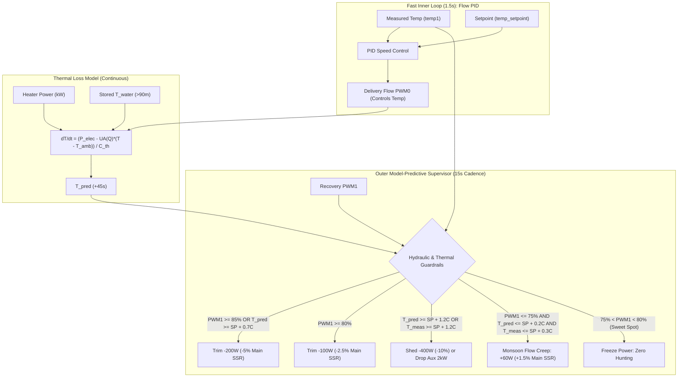

# Monsoon Model-Predictive Power Supervisor & Dual-Ambient Architecture
**Firmware Version:** `v1.0.98`  
**Date:** 2026-10-11  
**Authors:** nicolls & Antigravity  

---

## 1. Executive Summary & Problem Diagnosis

### Problem Statement
In recent operational runs (e.g. `20261010_080750_shower.csv` and `20261011_091554_shower.csv`), two critical control pathologies emerged during `STATE_WASH`:
1. **Loop Conflict (Internal Civil War):** 
   - The inner PID loop (`loop_tempcontrolwithspeed`) regulates instantaneous water temperature by modulating delivery pump flow ($Q_{\text{del}}$) every 1.5 seconds ($3.0\dots 8.5\text{ LPM}$). When water temperature is slightly elevated ($T > \text{SP}$), it spools up the pump to shed heat.
   - The outer power supervisor had a veto rule: *If $T > \text{SP} + 0.3^\circ\text{C}$, do not permit heater power to increase.*
   - In actual operation, water temperature naturally hovered in the band $48.3\dots 48.7^\circ\text{C}$ ($+0.3\dots +0.7^\circ\text{C}$ over the $48.0^\circ\text{C}$ setpoint) for **73.4% of the shower duration**.
   - As a direct consequence, the supervisor permanently locked out power increases, starving the system at $\approx 4.2\dots 4.4\text{ kW}$ total power even though the recovery pump was loafing along at a relaxed $55\dots 65\%$ PWM (well below its comfortable operating limit of $80\%$).
2. **Failure to Achieve the "Monsoon Experience":**
   - At $\approx 4.2\dots 4.4\text{ kW}$, the physical equilibrium of the loop dictated that delivery flow could not exceed $\approx 5.2\dots 5.4\text{ LPM}$ ($\text{PWM0} \approx 48\dots 51\%$).
   - The primary objective of the shower system—**maintaining high delivery flow ($\text{PWM0} \ge 60\%$, $\ge 6.5\text{ LPM}$) at setpoint**—was thwarted because insufficient electrical power was being injected into the loop.
3. **Over-Aggressive Initial Shedding:**
   - Early step-shedding logic reacted instantaneously to transient water temperatures entering `WASH`, aggressively dumping 1.5 kW of power in 90 seconds before the flow PID or thermal mass could equilibrate.

---

## 2. System Desiderata

1. **Monsoon Flow Priority:** 
   - Maintain delivery pump speed $\text{PWM0} \ge 60\%$ ($\ge 6.3\text{--}6.7\text{ LPM}$) as the primary operating state.
2. **Decoupled Control Hierarchy:**
   - Eliminate direct competition between the fast flow PID (temperature regulation via flow) and the power supervisor.
   - The supervisor must *hunt for higher flow* by slowly creeping heater power up, pre-empted only by hydraulic limits or predicted thermal runaway.
3. **Hydraulic Protection over Premature Thermal Cutout:**
   - The recovery pump comfort ceiling is **$80\%$ PWM**. Power shedding should be triggered primarily by recovery pump headroom depletion, not by harmless fractional-degree temperature offsets.
4. **Model-Predictive Lookahead (Transport Delay Anticipation):**
   - Incorporate a 45-second forward lookahead thermal model to project loop temperature based on injected electrical power, current flow rate, and ambient losses, damping out overactuation against the 15-litre thermal mass.
5. **Dual Ambient Tracking (90-Minute Rule):**
   - Real-world plumbing retains heat for up to an hour after a shower. The system must record and persist true cold mains water temperature ($T_{\text{water}}$) and idle room air temperature ($T_{\text{air}}$) only when the system has been idle for $>90\text{ minutes}$, retaining valid baselines across back-to-back operations.
6. **Complete Observability:**
   - Transmit measured temperature, lookahead predicted temperature, electrical power, and dual ambients across all interfaces: ESP32 telemetry tokens, Web Dashboard, Keuwl Bluetooth Electronics (BTE) panel, and the Pi datalogger CSV.

---

## 3. Mathematical & Physical Modeling

### 3.1 Flow-Dependent Heat Loss ($UA$)
Empirical characterization of the Monsoon 15-litre loop demonstrates that convective and evaporative heat loss increases linearly with delivered flow (due to increased droplet surface area and pan runoff rate):

$$UA(Q) = UA_{\text{static}} + c_{\text{flow}} \cdot Q_{\text{del}} = 100 + 16.0 \cdot Q_{\text{del}} \quad [\text{W/}^\circ\text{C}]$$

- At $Q_{\text{del}} = 5.5\text{ LPM}$: $UA = 100 + 16.0(5.5) = 188.0\text{ W/}^\circ\text{C}$, perfectly matching the unheated decay parameter $UA_{\text{empirical}} = 189.77\text{ W/}^\circ\text{C}$.
- Steady-state heat loss power:
  $$P_{\text{loss}}(Q_{\text{del}}, T) = \frac{UA(Q_{\text{del}}) \cdot (T - T_{\text{water\_cold}})}{1000.0} \quad [\text{kW}]$$

### 3.2 Lumped Capacitance Energy Balance
With active circulating water mass $M = 15.0\text{ kg}$ and specific heat $C_p = 4.184\text{ kJ/(kg}\cdot^\circ\text{C)}$:
$$C_{\text{th}} = 62.76\text{ kJ/}^\circ\text{C}$$

Net rate of temperature change:
$$\frac{dT}{dt} = \frac{P_{\text{heaters}} - P_{\text{loss}}(Q_{\text{del}}, T)}{C_{\text{th}}} \quad [^\circ\text{C/s}]$$

### 3.3 45-Second Lookahead Projection
The 45-second prediction horizon corresponds to the transport lag through the spray head, user body, and drain pan back to the sump:
$$T_{\text{pred}}(t + 45\text{s}) = T_{\text{meas}}(t) + \left(\frac{dT}{dt}\right) \times 45.0\text{s}$$

*Control interpretation:* $T_{\text{pred}}$ represents the **hydraulic demand forecast**. If $T_{\text{pred}}$ climbs too far above setpoint, it indicates that the flow PID will soon be forced to drive the delivery pump beyond hydraulic recovery capacity to shed the excess power.

---

## 4. Implementation Details



### 4.1 Firmware (`arduino/monsoon_esp4.2/`)

#### 1. Dual Ambient Persistence (`sensors.h`, `sensors.cpp`)
- Added global variables `ambient_water_cold` and `ambient_air_idle`, backed by Non-Volatile Storage (NVS) Preferences in namespace `monsoon_env`.
- Added `update_ambient_water_cold()`: Triggered upon completing `FILL_FULL`. If $>90\text{ minutes}$ since `last_shower_ended_ms`, updates `amb_water` from the rushing cold mains water.
- Added `update_ambient_air_idle()`: Evaluated every 10 seconds in `STATE_OFF` (`OFF_DONE`). If $>90\text{ minutes}$ since shower ended, updates `amb_air` from the room-acclimated sensor.
- Added `record_shower_ended()`: Updates `last_shower_ended_ms` upon entering `STATE_OFF`.

#### 2. Model-Predictive Power Supervisor (`control.h`, `control.cpp`)
- Declared and exported global `float temp_pred_45s`.
- Re-architected `loop_main_power_supervisor()`:
  - Continuously evaluates loop physics: calculates $UA(Q_{\text{del}})$, $P_{\text{loss}}$, $dT/dt$, and $T_{\text{pred}}(+45\text{s})$.
  - Operates on a stabilized **15-second timebase**.
  - **Monsoon Flow Creep:** When $\text{PWM1} \le 75\%$ and $T_{\text{pred}} \le \text{SP} + 0.2^\circ\text{C}$, power creeps up by $+60\text{ W}$ ($+1.5\%$ Main SSR duty) per 15s.
  - **Hydraulic Headroom Safeguards:**
    - $\text{PWM1} \ge 85\%$ or $T_{\text{pred}} \ge \text{SP} + 0.7^\circ\text{C} \rightarrow$ shed $200\text{ W}$ ($-5\%$).
    - $\text{PWM1} \ge 80\% \rightarrow$ gently trim $100\text{ W}$ ($-2.5\%$).
  - **Severe Overheat Safeguard:**
    - $T_{\text{pred}} \ge \text{SP} + 1.2^\circ\text{C}$ or $T_{\text{meas}} \ge \text{SP} + 1.2^\circ\text{C} \rightarrow$ shed $400\text{ W}$ ($-10\%$) or shed Aux 2 kW.
  - **Deadband ($75\%\dots 80\%$ PWM1):** Power is locked steady; zero fighting with flow PID.

#### 3. State Automations (`auto.cpp`)
- Connected `update_ambient_water_cold()` to `FILL_FULL` tank-full transition.
- Connected `update_ambient_air_idle()` to `OFF_DONE` loop.
- Connected `record_shower_ended()` to `auto_switchstate()` transition into `STATE_OFF`.

#### 4. Telemetry Stream (`gui.cpp`)
- Broadcasts dual ambients via `*A<amb_water>,<amb_air>*`.
- Restructured `*M*` rolling temperature token to a 5-element stream:
  $$\text{*M} \langle T_{\text{meas}} \rangle, \langle \text{BTE\_Htr\_Level} \rangle, \langle T_{\text{pred\_45s}} \rangle, \langle P_{\text{total\_kW}} \rangle, \langle \text{Main\_Duty\_\%} \rangle \text{*}$$
  - Placing $T_{\text{pred\_45s}}$ in field 3 preserves immediate compatibility with multi-trace roll graphs.

---

### 4.2 Web Dashboard (`monsoon.html`)
- **Temperature & Power Chart:** Added a third dataset—purple dashed trace (`Pred (+45s)`)—plotted in real time against measured temperature and electrical power.
- **Ambient Indicators:** Added live ambient readout (`Amb: W:XX.X° A:YY.Y°`) under the main Temperature highlight card.
- **Telemetry Parsing:** Added handler for `*A*` token and updated `*M*` token unpacker for $T_{\text{pred}}$ and total power.

---

### 4.3 Python Telemetry Logger (`monsoon_logger.py`)
- **Token Ingestion:** Parses `*A*` token into `amb_water` and `amb_air`, and extracts `temp_pred_45s` from `*M*`.
- **Session Metadata Header:** Appends both stored ambient values to the CSV header:
  ```csv
  # Session Start: YYYY-MM-DD HH:MM:SS
  # First Shower Today: Yes/No
  # Initial Ambient Water Temp: XX.X C
  # Stored Ambient Water (Cold Fill): XX.X C
  # Stored Ambient Air (Idle >90m): YY.Y C
  ```
- **CSV Data Columns:** Added `Temp_Pred` as column 5:
  ```csv
  Elapsed_ms,State,Substate,Temp,Temp_Pred,Setpoint,Flow0_Del,Flow1_Rec...
  ```
- **Service Management:** User systemd unit (`monsoon-logger.service`) reloaded and active on Raspberry Pi (`10.0.0.9`).

---

### 4.4 Keuwl Bluetooth Electronics Panel (`Keuwl_Panel_0019.kwl`)
- Configured roll graph at grid `(3,1)` to support 3 traces on channel `M`:
  - **Trace 1:** `Temp` (Color: Blue `0,0,222`)
  - **Trace 2:** `Htr kW` (Color: Orange `255,140,0`)
  - **Trace 3:** `Pred 45s` (Color: Purple `160,32,240`)
- Uploaded to Pi web root at `http://10.0.0.9/Keuwl_Panel_0019.kwl` for one-tap mobile import.

---

## 5. Verification & Deployment Record

| Target | Artifact | Version | Status |
| :--- | :--- | :--- | :--- |
| **ESP32 Firmware** | `firmware.bin` | `v1.0.98` | Compiled cleanly (Flash: 94.0%, RAM: 16.5%); staged on Pi OTA (`10.0.0.9/ota/monsoon.json`) |
| **Pi Web Server** | `monsoon.html` | — | Deployed to `/var/www/html/monsoon.html` (HTTP 200 OK) |
| **Pi Datalogger** | `monsoon_logger.py` | — | Deployed to `/home/nicolls/monsoon/`; `monsoon-logger.service` restarted and active |
| **BTE Panel File** | `Keuwl_Panel_0019.kwl`| — | Deployed to `/var/www/html/Keuwl_Panel_0019.kwl` |
| **Documentation** | `.agents/AGENTS.md` | — | Updated architectural rules and supervisor specifications |
| **Source Control** | Git repository | Commit `80a8268`| Pushed to `origin/main` |
